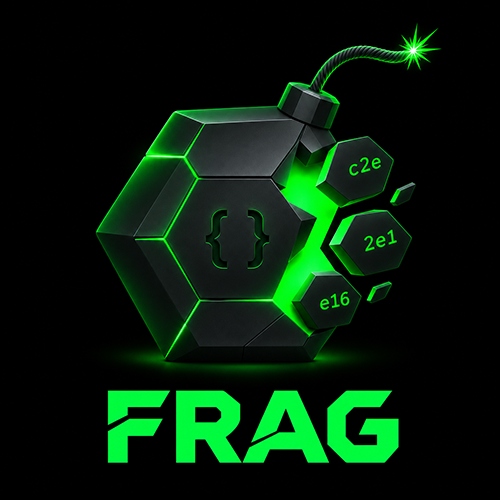

<p align="center">
  
</p>

<p align="center"><em>CSS token exfiltration tool</em></p>

## What is Frag?

Frag is a tool for extracting secret tokens from web pages using only CSS — no JavaScript required. It generates CSS payloads that use attribute selectors and `background-image` URLs to exfiltrate overlapping token fragments to an attacker-controlled server, then reconstructs the full token using De Bruijn graph traversal and Eulerian path algorithms.

This is useful in contexts where CSS injection is possible but JavaScript is blocked — such as webmail clients, HTML email rendering, or pages with strict Content Security Policies.

## How it works

1. **Fragment exfiltration** — CSS attribute selectors (`^=`, `*=`, `$=`) match overlapping chunks of a token embedded in an element's attribute. Each matching selector triggers a `background-image` request to your server, revealing which chunk was present.

2. **Graph reconstruction** — The received chunks are modelled as edges in a De Bruijn graph. Frag finds an Eulerian path through the graph to reconstruct the original token, using the Chinese Postman Problem for handling repeated chunks.

3. **Noise removal** — Chunks that come from known parts of the URL (not the token itself) are identified and filtered out using context-based analysis.

4. **Token length filtering** — A known token length is used to reject incorrect reconstructions and filter self-loop candidates.

## Features

- Web UI for configuration, payload generation, and live token display
- Support for anchor elements (`<a href="...">`) and hidden inputs (`<input type="hidden">`)
- Two copy modes: HTML (for pasting into contenteditable test pages) and plain text (for exploitation)
- Sample token with test HTML for verifying payloads in-browser
- Real-time stitching as chunks arrive

## Getting started

```bash
npm install
node server.js
```

Then visit `http://localhost:3000` in your browser.

### Configuration

Use the web UI to configure:

| Field | Description |
|-------|-------------|
| **type** | Element type — Anchor or Hidden Input |
| **selector** | CSS selector matching the target element |
| **attr** | Attribute containing the token |
| **name** | Display name for the token |
| **start** | Known text immediately before the token |
| **end** | Known text immediately after the token |
| **length** | Expected token length (improves stitching accuracy) |

### Usage

1. Configure the target element and token parameters
2. Click **Apply** to update the server
3. Copy the generated CSS payload
4. Inject the CSS into the target page
5. Watch the token appear in the terminal as chunks arrive

## Background

The original concept for CSS-only token exfiltration was developed by [Gareth Heyes](https://portswigger.net/research/css-the-bomb-inside-your-inbox), demonstrating how CSS attribute selectors and background image requests could be weaponised to steal tokens from webmail clients — without any JavaScript. The initial technique worked for short tokens but required very large stylesheets (~258 MB for a 12-character hex token).

[Alex Craig](https://portswigger.net/research/smashing-the-token-limit) dramatically improved the technique by reframing extraction as overlap-based reconstruction using graph theory. By using overlapping fragment chunks instead of brute-forcing individual characters, Alex reduced the CSS size by over 1,000x for 12-character tokens (down to ~1.33 MB at 99% success rate) and scaled the approach to extract tokens of 210+ hex characters within the original byte budget.

## Credits

- **Gareth Heyes** — Original concept, initial research ([CSS: the bomb inside your inbox](https://portswigger.net/research/css-the-bomb-inside-your-inbox)), and tool author
- **Alex Craig** — Overlap-based reconstruction technique, validation framework, and scalability improvements ([Smashing the token limit](https://portswigger.net/research/smashing-the-token-limit))
