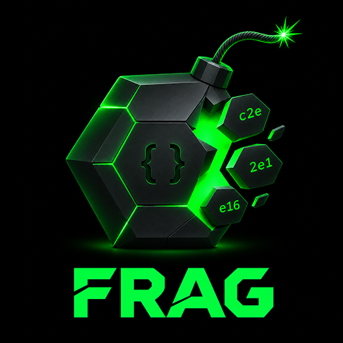

<p align="center">
  
</p>

<p align="center"><em>CSS token exfiltration tool</em></p>

## What is Frag?

Frag is a tool for extracting secret tokens from web pages using only CSS — no JavaScript required. It generates CSS payloads that use attribute selectors and `background-image` URLs to exfiltrate overlapping token fragments to an attacker-controlled server, then reconstructs the full token using De Bruijn graph traversal and Eulerian path algorithms.

This is useful in contexts where CSS injection is possible but JavaScript is blocked — such as webmail clients, HTML email rendering, or pages with strict Content Security Policies.

Frag extracts lowercase hex tokens (`0-9a-f`), and also mixed-case alphanumeric (`A-Za-z0-9`), base64 (`A-Za-z0-9+/=`) and base64url (`A-Za-z0-9-_`) tokens. See [Charsets](#charsets).

## How it works

1. **Fragment exfiltration** — For every possible window of 3 or 4 characters in the token's charset, a CSS attribute selector (`*=`) fires a `background-image` request to your server if the token's attribute contains it. Two small rule sets (`^=`/`$=`, or `*=` with the known surrounding text) leak the token's first and last two characters.

2. **Reconstruction** — Frag builds the token one character at a time, keeping only tokens of the configured length that match the leaked start and end and contain nothing but leaked windows.

3. **Noise handling** — Charset characters from the rest of the attribute (e.g. `bac` in `callback`, or junk query parameters) also leaks and can link into the token. Candidates are ranked by how cheaply the windows they leave unused can be explained as one contiguous run of junk, so junk is left over rather than spliced into the token.

4. **Ambiguity reporting** — Only the *set* of windows leaks, not their order or count, so different tokens can leak identical data. When that happens every equally plausible token is listed as a candidate rather than one being picked at random.

### Window size

The window size trades CSS size against accuracy. Measured on random hex tokens in an anchor href followed by random hex junk:

| Window | CSS | Single correct guess, 12 chars | 24 chars | 40 chars | 64 chars |
|---|---|---|---|---|---|
| 4 chars (default) | ~4.03 MB | 100% | 100% | 99.5% | ~97% |
| 3 chars | ~260 KB | ~97% | ~72% | ~28% | ~1% |

With 3-char windows the real token is still in the candidate list ~98% of the time at 40 chars; it just isn't the only answer. CSS size also grows with the length of your server's origin, since it appears in every rule.

Unmatched probes contribute no background layer: each matched custom property contains `url(...),`, and the background joins empty fallbacks such as `var(--a,)var(--b,)none`. Frag conservatively retains its limit of 25,000 probe references per box, introduced after large background lists crashed Chrome. The 4-char hex payload and every non-hex payload still spread references across the element and its `::before`/`::after`. Any existing pseudo-element content is replaced, and if the page's styles override their backgrounds, those windows won't leak. The 3-char hex payload uses only the element itself.

CSS sizes above are UTF-8 bytes (decimal KB/MB) for the anchor preset with an HTTP `127.0.0.1:3000` collector. Compact property names, short attribute-value escapes, empty fallbacks and the abbreviated IPv4 collector reduce the four-character payload from 4.67 MB to 4.03 MB without removing probes. Blind extraction additionally nests repeated field selectors and combines equivalent URL-start probes: a four-character `csrf` input on a form drops from 7.12 MB to 5.09 MB, and an anchor's `token` parameter from 6.68 MB to 4.35 MB. With `localhost:3000`, which must keep its hostname, the targeted payload is ~4.30 MB (four characters) or ~278 KB (three characters).

### Charsets

Probing every mixed-case window doesn't scale: 3-char alphanumeric windows alone would be 62³ = 238,328 rules (~15 MB), and would need about ten 25,000-layer boxes when an element only has three. Non-hex charsets therefore leak two smaller sets in one payload:

- **Case-insensitive 3-char windows** (`[href*=abc i]`) over the lowercased alphabet: 36 characters for alphanumeric, 39 for base64, 38 for base64url. They reconstruct the token in lowercase exactly as hex does. 36³ windows are about as sparse as hex's 16⁴, so accuracy is close to 4-char hex.
- **Case-sensitive 2-char windows that contain a letter** (`[href*=aB]`, sent as `/c/aB`), about 3,700–4,100 rules. Each letter's case is chosen so that every pair in the cased token leaked. A casing that leaves the token's own leaked pairs unexplained ranks lower. Pairs from the known surrounding text are expected leftovers.

A `/` in a leaked chunk is sent as `%2F` so it stays in one path segment. Non-hex charsets only offer 3-char windows: 4-char ones would need 1.7M+ rules. The start and end rules match up to 8 characters of the known text around the token rather than 2, because a bigger alphabet would also match elsewhere in the URL, e.g. `n=lo` in `&operation=login`.

Measured on random tokens in the anchor preset (with and without random junk in the same charset after the href) and in a hidden input (`test/stitch.test.js`):

| Charset | CSS (anchor / hidden) | Single correct guess, 6–40 chars | 64 chars | Token listed, 6–40 chars |
|---|---|---|---|---|
| alphanumeric | ~3.17 / 3.31 MB | ~98% | ~77–85% | 100% |
| base64 | ~3.99 / 4.17 MB | ~99% | ~75–85% | 100% |
| base64url | ~3.69 / 3.85 MB | ~99% | ~75–85% | 100% |

Case ties (e.g. a lowercase copy of part of the token elsewhere in the attribute) come back as candidates. If no casing fits at all, e.g. because a pair request was lost, the token is returned in lowercase and flagged as such. Base64 inside URLs is often percent-encoded (`%2B`, `%2F`, `%3D`), which these windows won't match, so use base64url or another field there.

When testing in the UI, inject each payload into a fresh page: a browser won't re-request an image URL it already loaded in the same page, and alphanumeric, base64 and base64url share most window URLs.

The server treats a quiet gap of one second as the boundary between extractions: it waits for that gap before stitching, so a poll mid-burst can't lock in a reconstruction from partial data, and the first request after a gap starts a fresh extraction.

## Blind mode

Blind mode extracts tokens from a page you don't have selectors for. It only uses `background-image` requests, so it works where `@import` is blocked. Without `@import` there's no recursion: each injection is one static stylesheet. So blind mode runs in two stages.

1. **Recon** (~129 KB). Wordlist probes report:
   - which fields exist: hidden/other inputs by `name`, `<meta name>`, `?name=` params in `a[href]` and `form[action]`, and `data-*` attributes
   - which element can host the extraction requests
   - which charset each input, meta and data value looks like. A value is in a charset if it contains none of a list of common characters that rule it out. Only hex, base64 and base64url are probed: a value that passes both base64 tests contains none of `-_/+=`, so it is alphanumeric. URL param values aren't probed, so you pick their charset.

   CSS can't enumerate attribute names or read values, so names can only come from the wordlists in `public/blind.js`. A hidden input whose name isn't listed is flagged but can't be extracted.

2. **Extract**. Pick fields from the recon results, adjust each field's charset if needed, and frag builds a payload for them. It's like targeted mode, but every URL is namespaced by field (`/b/<id>/abcd`). That's because the browser only loads an identical URL once, so windows from different fields would otherwise be indistinguishable. The token length isn't known, so the solver tries a range of lengths:
   - **Whole values** (input, meta, data-\*): the shortest token that uses every leaked window.
   - **URL params**: candidates are ranked by how many characters they need for the token plus the junk around it. These payloads also leak where each param value starts (`=ab`) and every possible end (`ab&`, `ab#`, end of URL). Leftovers that start or end mid-value then count against a candidate.

Usage: switch the UI to **blind**, copy the recon payload, inject it, then pick the discovered fields, copy the extract payload and inject that. The test area has a sample page with one field of each kind.

### Hosts

Hidden inputs and `<meta>` don't render, so their requests need another element:

| Field | Host | Notes |
|---|---|---|
| input in a rendered form | `form:has(>input[name=… i][value*=…])` | Fast (~0.1 s for 65k rules) |
| other inputs | `html:has(input[…])` | Cost grows with page size (~3 s for 4-char windows on a 3,000-element page) |
| meta | the meta itself, with `head,meta{display:block}` | |
| `a`/`form` params, `data-*` | the element itself | |

Recon checks the form host by firing its probe *from* the form, so a `display:none` form isn't used. Each kind of host is one element plus its `::before`/`::after`. That holds one 4-char hex field, one non-hex field, or about 16 3-char hex fields. When a kind is full, inputs and data attributes fall back to `html`, and if nothing fits frag asks you to use 3-char windows or a separate pass. Hosts replace the background, and `::before`/`::after`, of the elements they're on.

### Accuracy and size

Measured with random tokens and unknown length (`test/blind.test.js`). The URL-param case has random junk params in the same charset before and after the token.

| Field | Charset / window | CSS per field | Single correct guess | Token listed |
|---|---|---|---|---|
| input / meta / data | hex, 4 chars | ~4.49–5.09 MB | ~95% (6–64 chars) | 100% |
| input / meta / data | hex, 3 chars | ~0.29–0.34 MB | ~60% (6–40 chars) | ~99% |
| input / meta / data | non-hex, 3 chars + case pairs | ~3.5–5.0 MB | ~85–90% (6–64 chars) | 100% |
| URL param with junk | hex, 4 chars | ~4.35–4.49 MB | ~70% (8–64 chars) | 100% |
| URL param with junk | hex, 3 chars | ~0.34–0.35 MB | rare | ~85% (8–24 chars) |
| URL param with junk | non-hex, 3 chars + case pairs | ~3.7–4.6 MB | ~25–65% (8–40 chars) | ~95% |

With a non-hex charset most of the URL leaks as junk too (`https`, `example`, `callback`…), so URL params are ambiguous more often.

A whole value that repeats a substring (e.g. `fffff`) leaks the same windows as one with fewer repeats, so every length that fits is listed, shortest first. URL params are ambiguous more often because a chance overlap can let the token's tail swap with a junk param's. Both splits then fit the leaked data equally well, so both are listed.

### Chrome behaviour this relies on

- A stylesheet with more than 2^18 (262,144) rules is silently ignored, so payloads with several 4-char fields are split over multiple `<style>` elements.
- Flat rules keep attribute tests inside `:is()` to avoid Chrome's slow stylesheet construction for top-level attribute selectors. Nested extraction rules use `&[href*=abcd]`: an additional `:is()` around each nested test did not improve Chrome timings and costs five bytes per rule.
- Sibling hosts (`input[…] ~ *`) put every rule in Chrome's universal bucket and hung the tab on a 3,000-element page. Blind mode doesn't use them.

## Features

- Web UI for configuration, payload generation, and live token display
- Support for anchor elements (`<a href="...">`) and hidden inputs (`<input type="hidden">`)
- Hex, alphanumeric, base64 and base64url tokens, letter case included
- Two copy modes: HTML (for pasting into contenteditable test pages) and plain text (for exploitation)
- Sample token with test HTML for verifying payloads in-browser
- Automatic stitching once a burst of requests has finished
- Blind mode: discovers fields from wordlists and extracts tokens of unknown length without selectors

## Getting started

```bash
npm install
node server.js
```

Then visit `http://localhost:3000` in your browser.

Generated collector URLs abbreviate HTTP `127.0.0.1` to `127.1`, keeping the port: `http://127.1:3000`. Browsers normalize these to the same origin. `localhost` is preserved because it is a distinct origin for CSP and may resolve to IPv6. HTTPS hostnames, IPv6 addresses and external collectors are also preserved.

### Configuration

Use the web UI to configure:

| Field | Description |
|-------|-------------|
| **type** | Element type — Anchor or Hidden Input |
| **selector** | CSS selector matching the target element |
| **attr** | Attribute containing the token |
| **name** | Display name for the token |
| **start** | Known text immediately before the token |
| **end** | Known text immediately after the token |
| **length** | Expected token length |
| **charset** | hex (`0-9a-f`), alphanumeric (`A-Za-z0-9`), base64 (`A-Za-z0-9+/=`) or base64url (`A-Za-z0-9-_`). See [Charsets](#charsets) |
| **window** | Hex: 4 chars (~99% accurate, ~4.03 MB) or 3 chars (~260 KB, longer tokens may give candidates). Other charsets: 3 chars plus case pairs (~3.2–4.2 MB) |
| **host** | Hidden inputs only: which element fires the requests. `next sibling (+)` uses `input+*` — smallest, but fails if the input has no rendering next sibling (e.g. it's the last child or another non-rendering element follows it). `html:has()` hosts on the root via `html:has(input…)`, which survives those cases at the cost of one `:has()` test per rule. Anchors render themselves, so this is ignored for them. |

### Testing

```bash
npm test
```

The tests generate random tokens of every length from 6 to 40 in each charset, embed them in anchors (with and without random junk on the end of the href) and hidden inputs, work out which requests the real CSS payload (`public/payload.js`) would trigger, and check the stitched result. `test/blind.test.js` does the same for blind mode. It evaluates the recon and extract rules against a small model of a page (`test/blind-helpers.js`), from the same rule data the CSS is rendered from. Runs are seeded; use `FRAG_SEED=<n> npm test` to try a different set of tokens.

`npm test` also runs actual Chrome rendering and HTTP-request checks (or run them alone with `npm run test:browser`). Chrome/Chromium is detected in common macOS/Linux locations; set `CHROME_BIN` for another installation. When no browser is found the checks are skipped so the portable suite still passes; set `FRAG_REQUIRE_BROWSER=1` (e.g. in CI, alongside an installed Chrome) to make a missing browser a failure instead.

The browser checks use an isolated temporary browser profile and a local HTTP server. They cover both window sizes, every charset (stitching each mixed-case token from the requests Chrome actually made), all extraction hosts, recon retained during extraction, every input/meta recon name with mixed values, escaped values, compact property names, URL separators and case, empty and repeated matches, shared hosts, stylesheet splitting and same-origin CSP with a localhost collector. They compare parsed probes, computed backgrounds and received requests with the expected fragments.

### Usage

1. Configure the target element and token parameters (changes apply to the server automatically)
2. Copy the generated CSS payload
3. Inject the CSS into the target page
4. Watch the token appear in the terminal as chunks arrive

## Background

The original concept for CSS-only token exfiltration was developed by [Gareth Heyes](https://portswigger.net/research/css-the-bomb-inside-your-inbox), demonstrating how CSS attribute selectors and background image requests could be weaponised to steal tokens from webmail clients — without any JavaScript. The initial technique worked for short tokens but required very large stylesheets (~258 MB for a 12-character hex token).

[Alex Craig](https://portswigger.net/research/smashing-the-token-limit) dramatically improved the technique by reframing extraction as overlap-based reconstruction using graph theory. By using overlapping fragment chunks instead of brute-forcing individual characters, Alex reduced the CSS size by over 1,000x for 12-character tokens (down to ~1.33 MB at 99% success rate) and scaled the approach to extract tokens of 210+ hex characters within the original byte budget.

## Credits

- **Gareth Heyes** — Original concept, initial research ([CSS: the bomb inside your inbox](https://portswigger.net/research/css-the-bomb-inside-your-inbox)), and tool author
- **Alex Craig** — Overlap-based reconstruction technique, validation framework, and scalability improvements ([Smashing the token limit](https://portswigger.net/research/smashing-the-token-limit))
